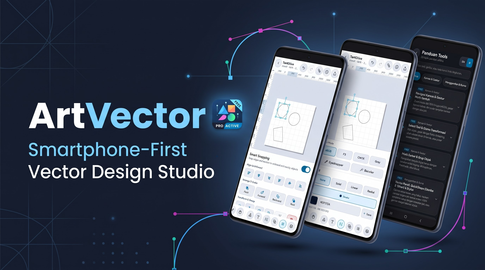
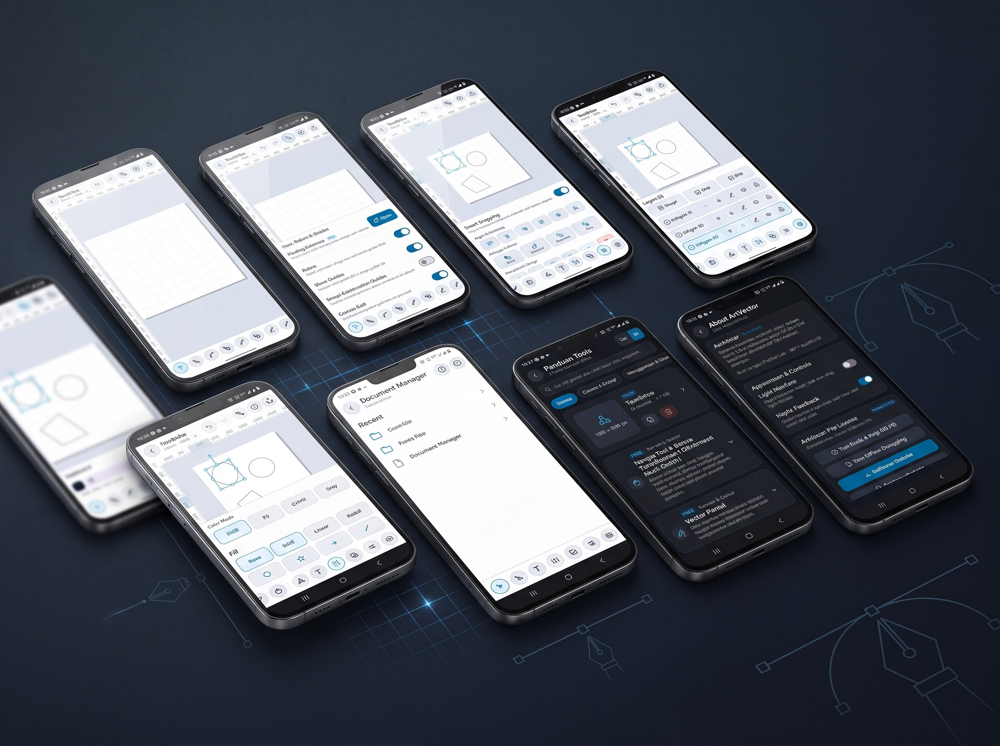

# ArtVector

**ArtVector** is a smartphone-first vector illustration and graphic design studio built for Android by **Igoy Creative Lab.**

Create crisp, resolution-independent vector artwork anywhere directly from your phone, whether you are designing logos, icons, stickers, social media carousels, badges, or print-ready layouts.

## Workspace & Interface



## Key Capabilities (Free Tier)

- **Parametric Vector Shapes:** Create and customize 8 live shapes (Rectangle, Rounded Rectangle, Ellipse, Triangle, Polygon, Star, Arrow, and Line) with on-canvas drawing, live dimension badges, and `1:1` / `45°` lock.
- **Bezier Pen & Node Editor:** Plot precision cubic Bezier curves with an optional touch-offset crosshair, convert shapes to curves, edit anchors and tangent handles directly, retract/split handles, subdivide, break, or join open paths.
- **Vector Pencil, QuickShape & Stylus Support:** Sketch smooth freehand curves, **Draw & Hold (QuickShape)** to auto-snap rough strokes into 100% round circles, ellipses, straight lines, arcs, rectangles, squares, triangles, or polygons, and draw variable-width calligraphic strokes with stylus pressure calibration, hover reticle, and Palm Rejection.
- **Shape Builder, Knife & Full Pathfinder Suite:** Swipe across overlapping regions to merge or erase with Shape Builder, slice shapes cleanly with the Knife tool, and run 10 Boolean/Pathfinder operations plus Expand Stroke, Offset Path, Live Corner Rounding, and Simplify Path.
- **Full Color Studio, Gradients & Vector Text:** Solid, Linear, and Radial gradients with draggable on-canvas handles; decimal stroke controls (Center/Inside/Outside align, caps, joins, dashes); Eyedropper loupe; HSB/RGB/CMYK/HSL/Grayscale picker; custom `.ttf`/`.otf` typography, Text on Path, and Convert to Outlines.
- **Rulers, Guides, Layers & Free Reference Tracing:** Two-finger pinch-zoom (`15% to 6400%`), pan, and canvas view rotation; draggable ruler guides, Smart Snapping, Shape Construction Guides, Clipping Masks, and free Reference Image tracing layers (`PNG`, `JPEG`, `WebP`).
- **In-App Bilingual Tool Guide (EN / ID):** Tap **Help (`?`)** anywhere in the Editor, Gallery, or About screen for 23 offline step-by-step tool guides with instant search and automatic active-tool highlighting.
- **Raster Export & Project Management:** Export crisp `PNG` (transparent or opaque), `JPEG`, and `WebP` (`1x to 4x`, `72 to 300 DPI` with embedded DPI metadata), organize projects in the gallery with 30-day Trash recovery, and create full `.artvector-backup` local archives.

## ArtVector Pro

Unlock professional print, cutting, and production workflows with an offline **ArtVector Pro** license:

- **Vector & Print-Ready Export:** Pure `SVG`, Web-Minified `SVG`, and Print-Ready `PDF` & `EPS` in **CMYK**, **Display P3**, **sRGB**, or **Grayscale** with millimeter **Bleed** and **Crop Marks**.
- **Ultra-HD Raster, Preflight & Delivery Pack:** Export `6x` / `8x` (up to `8192px`, `600 DPI`, 16-bit Display P3), run automatic print Preflight with one-tap Auto-Fix, and package `EPS + SVG + PDF + Transparent PNG + 4096px JPG Preview + Report` into a single `.zip` Delivery Pack.
- **Image Trace & Vector Import:** Auto-vectorize Reference Image layers offline (B&W Logo, Silhouette, 4/8/12 Colors), import external `.svg` and `.eps` artwork, and open a pinch-zoomable **Floating Reference Window**.
- **Pro Studio Expansion:** **Multi-Artboard & Multi-Page Vector PDF**, **Seamless Pattern Studio** (Grid, Brick, Half-Drop, Hex + SVG `<pattern>`), **Auto Die-Cut / Kiss-Cut Contours & `.DXF` / Cutting SVG Plotter Export**, **Parametric Repeater** (Radial, Grid, Symmetry), **Blend Tool** (with curved spine), **Recolor Artwork**, **Cross-Project Symbol Library**, and desktop **`.ASE` / `.GPL` / `.JSON`** swatch palettes.

## Download & Install

Official signed Android builds are published on the [Releases](https://github.com/ogibinedi/artvector-releases/releases) page.

| File | Recommended For |
| --- | --- |
| `artvector-<version>-android-arm64.apk` | Most modern Android smartphones (64-bit ARM, Android 8.0+) |
| `artvector-<version>-android-legacy-armeabi-v7a.apk` | Older 32-bit ARM Android devices |
| `SHA256SUMS.txt` | SHA-256 checksums to verify downloaded APKs |

### Verifying Checksums

```bash
sha256sum -c SHA256SUMS.txt --ignore-missing
```

### In-App Updates

ArtVector includes a built-in **Software Updates** checker (under **About -> Software Updates**) that checks this repository directly and verifies APK SHA-256 checksums before installation. Enable **Include pre-releases** to test Release Candidate (`-rc`) builds early.

## About This Repository

This public repository serves strictly as the official binary release distribution channel for **ArtVector** by **Igoy Creative Lab.**
